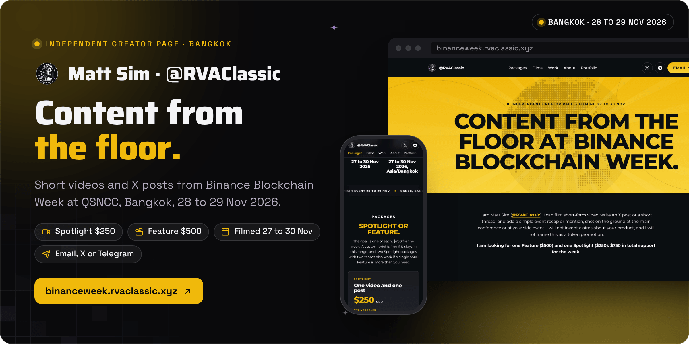
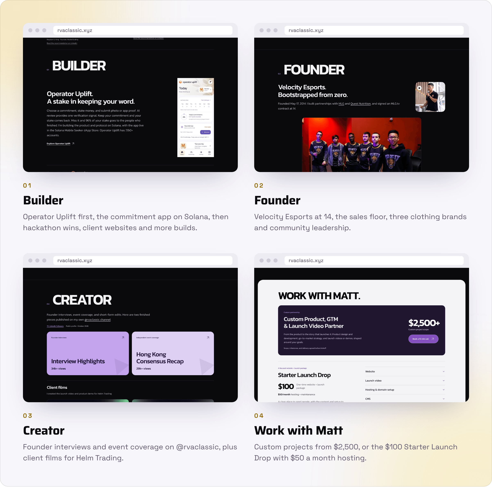

<div align="center">



<p align="center"><sub>Archived screenshot of the previous sponsor page. The current offer is the Bangkok creator page described below.</sub></p>

<br><br>

<a href="https://binanceweek.rvaclassic.xyz/#packages"></a>&nbsp;&nbsp;
<a href="https://rvaclassic.xyz"></a>&nbsp;&nbsp;
<a href="mailto:matthew.d.sim@gmail.com"></a>

<br><br>


<a href="LICENSE"></a>

<h3>Content from the floor at Binance Blockchain Week.</h3>

<b>Meet Matt</b> &nbsp;→&nbsp; <b>See the posts</b> &nbsp;→&nbsp; <b>Pick Spotlight or Feature</b> &nbsp;→&nbsp; <b>Email Matt</b>

<br>

<a href="#how-it-works">How it works</a> &nbsp;·&nbsp;
<a href="#the-packages">Packages</a> &nbsp;·&nbsp;
<a href="#the-portfolio-at-rvaclassicxyz">Portfolio</a> &nbsp;·&nbsp;
<a href="#status">Status</a> &nbsp;·&nbsp;
<a href="#run-it-locally">Run it locally</a> &nbsp;·&nbsp;
<a href="#credits-and-sources">Credits</a>

</div>

<br>

**This is an independent creator page for Matt Sim (@RVAClassic).** It offers two content packages for Binance Blockchain Week at QSNCC, Bangkok. The main event is 28–29 Nov 2026. Side events run 27–30 Nov 2026. The page is meant to be served at [binanceweek.rvaclassic.xyz](https://binanceweek.rvaclassic.xyz). It does not use the event company's marks, and the footer states that the page is not affiliated with or endorsed by Binance.

There is no checkout. Each package button opens an email to matthew.d.sim@gmail.com with the package in the subject line, and sponsors can also message [@RVAClassic on X](https://x.com/RVAClassic) or [@operatoruplift on Telegram](https://t.me/operatoruplift). Matt is looking for one Feature ($500) and one Spotlight ($250), $750 in total support for the week. The offer is a draft: nothing has been sent or booked.

The same repository serves Matt's portfolio at [rvaclassic.xyz](https://rvaclassic.xyz). Both sites are hand-written static files in `dist/`, with no framework and no build step. The previous sponsor page remains in git history.

<br>

## How it works

<table>
  <tr valign="top">
    <td width="33%"><b>No build step</b><br><sub>Hand-written HTML, CSS and JavaScript in <code>dist/</code>. Vercel runs no install or build command and serves the folder exactly as committed.</sub></td>
    <td width="33%"><b>One deploy, host routing</b><br><sub><a href="vercel.json"><code>vercel.json</code></a> sends <code>rvaclassic.xyz</code> to the portfolio, and sends <code>/llms.txt</code> on the sponsor hosts and on <code>*.vercel.app</code> to the Bangkok offer file.</sub></td>
    <td width="33%"><b>Email, X or Telegram</b><br><sub>Sponsors write to matthew.d.sim@gmail.com (Spotlight uses the subject “Binance Week Spotlight ($250)”, Feature uses “Binance Week Feature ($500)”), or message @RVAClassic on X or @operatoruplift on Telegram.</sub></td>
  </tr>
</table>

<p align="center"><sub>Static HTML · CSS · Montserrat from Google Fonts · Vercel host routing</sub></p>

<br>

## The packages

As listed on the sponsor page. Figures for the X posts were pulled Nov 22, 2026.

<table>
  <tr>
    <th width="22%" align="left">Package</th>
    <th width="14%" align="left">Price</th>
    <th width="64%" align="left">What the sponsor gets</th>
  </tr>
  <tr valign="top">
    <td><b>Spotlight</b></td>
    <td>$250</td>
    <td>1 short video (about 15–60s) filmed at your booth, stage, or side event, plus 1 X post from @RVAClassic. You may repost or embed the finished pieces, with credit.</td>
  </tr>
  <tr valign="top">
    <td><b>Feature</b></td>
    <td>$500</td>
    <td>2 short videos, 1 X thread (or a longer recap post), and a mention in an event recap. Same usage, plus the raw clip on request.</td>
  </tr>
</table>

Filmed 27–30 Nov 2026 (Asia/Bangkok). Delivered within 72 hours of filming. What is not included: guaranteed view counts, token or trading calls, or any post that goes out before you have seen the draft if you want a review.

<br>

## The portfolio at rvaclassic.xyz

<picture>
  <source media="(prefers-color-scheme: dark)" srcset="docs/readme/portfolio-dark.png">
  
</picture>

<p align="center"><sub>Captured from a local copy of <code>dist/portfolio/</code> on 30 October 2026. The hero is not shown: its sky video and 3D art load from remote hosts this environment cannot reach.</sub></p>

[`dist/portfolio/`](dist/portfolio) is Matt's portfolio, served at the apex domain. It has Builder, Founder, Events and Creator sections, with all 19 hackathon prize finishes listed under Builder, a Featured in section with interviews and articles, and Matt's services: custom product, GTM and launch video projects from $2,500, the Starter Launch Drop (a $100 one-time website and launch package, plus $50 a month for hosting and maintenance), and separately quoted video, design, social and business development work. The public RVAClassic brand kit lives at [`/portfolio/brand/`](dist/portfolio/brand), with logos, favicons, fonts, tokens and the brand guide. [`brand.md`](brand.md) records the palette, type, voice and pricing rules.

<br>

## Status

<table>
  <tr valign="top">
    <td width="16%" align="center"></td>
    <td>The sponsor page is written for <a href="https://binanceweek.rvaclassic.xyz">binanceweek.rvaclassic.xyz</a>. This repository does not attach that domain or change DNS. Main event 28–29 Nov 2026 at QSNCC, Bangkok. Side events 27–30 Nov 2026. Filming 27–30 Nov 2026 (Asia/Bangkok), with delivery within 72 hours.</td>
    <td width="22%"><a href="https://binanceweek.rvaclassic.xyz">Sponsor page</a></td>
  </tr>
  <tr valign="top">
    <td align="center"></td>
    <td>$750 in total support for the week: one Feature ($500) and one Spotlight ($250).</td>
    <td><a href="mailto:matthew.d.sim@gmail.com">matthew.d.sim@gmail.com</a></td>
  </tr>
  <tr valign="top">
    <td align="center"></td>
    <td>Matt's portfolio at <a href="https://rvaclassic.xyz">rvaclassic.xyz</a>, with the brand kit at <code>/portfolio/brand/</code>. Served from this repository by host routing.</td>
    <td><a href="https://rvaclassic.xyz">Portfolio</a></td>
  </tr>
</table>

<br>

## Run it locally

<table>
  <tr valign="top">
    <td width="33%"><b>Prerequisites</b><br><sub>Python 3, or any static file server. Nothing to install or build.</sub></td>
    <td width="33%"><b>Read first</b><br><sub><a href="brand.md">brand.md</a> for the portfolio palette, type and voice, and the <a href="dist/assets/fonts/README.md">font notes</a> before touching typography.</sub></td>
    <td width="33%"><b>What is not here</b><br><sub>No backend, forms, payments or analytics, and no tests. Sponsors book by email to matthew.d.sim@gmail.com, or on X or Telegram.</sub></td>
  </tr>
</table>

```bash
python3 -m http.server 8080 --directory dist   # serves the folder as is
```

Open http://localhost:8080 for the sponsor page and http://localhost:8080/portfolio/ for the portfolio. Host routing in `vercel.json` only runs on Vercel, so locally the portfolio stays at `/portfolio/`. Its hero sky video, 3D art and Google Fonts need an internet connection.

<details>
<summary><b>Deploy and routing</b></summary>
<br>

The GitHub repository is connected to Vercel. Pushes to `main` deploy the production site. Vercel serves `dist/` directly with the Other framework preset and no build or install command. DNS is managed outside this repository. This change does not edit domain settings.

`vercel.json` routes the apex domain to the portfolio before filesystem handling. `binanceweek.rvaclassic.xyz` and preview hosts serve the sponsor page from `dist/index.html`. Shared assets stay under `dist/assets/`.

| Request | `rvaclassic.xyz` | `binanceweek.rvaclassic.xyz` | `*.vercel.app` |
|---|---|---|---|
| `/` | Portfolio (`portfolio/index.html`) | Sponsor page | Sponsor page |
| `/portfolio/` | Portfolio | 308 redirect to `https://rvaclassic.xyz/` | Portfolio |
| `/robots.txt` | `robots-apex.txt` | `robots.txt` | `robots.txt` |
| `/sitemap.xml` | `sitemap-apex.xml` | `sitemap.xml` | `sitemap.xml` |
| `/llms.txt` | `llms-apex.txt` | `llms-binanceweek.txt` | `llms-binanceweek.txt` |

Public source: https://github.com/operatoruplift/send-matt-to-breakpoint

</details>

<details>
<summary><b>Site files</b></summary>
<br>

| Path | Contents |
|---|---|
| `dist/index.html` | Sponsor page, Spotlight and Feature, and social metadata for binanceweek.rvaclassic.xyz |
| `dist/styles.css` | Event-site palette, yellow poster hero, pill buttons, Montserrat, and the motion layer (reveals, timeline, ticker, reduced-motion rules) for the sponsor page |
| `dist/bbw.js` | Sponsor-page motion: the halftone globe drawn on a canvas (turns toward Bangkok, pauses off screen and for reduced motion), scroll reveals, count-ups, section highlight, the mobile action bar and silent film previews |
| `dist/assets/land-mask.png` | 360×180 one-bit land and sea grid the globe samples, downsampled from the earth specular map in the three.js examples |
| `dist/site.js` | Unused video-dialog helper kept from the previous page |
| `dist/journey.js`, `dist/journey.css` | Previous page animation, not loaded by the current sponsor page |
| `dist/assets/` | Locally served images, fonts, illustrations and the sponsorship video |
| `dist/portfolio/index.html` | The portfolio: Builder, Founder, Events, Creator, services and Featured in, with JSON-LD |
| `dist/portfolio/hero.css`, `hero.js` | The responsive sky and projector hero, with reduced-motion and visibility support |
| `dist/portfolio/body.css`, `body.js` | Portfolio sections and progressive entrance effects |
| `dist/portfolio/evidence.css` | Event case studies, sourced hackathon results, creative portfolio links and media appearances |
| `dist/portfolio/projects.css`, `build-previews.css`, `build-previews.js` | The client website case study, featured builds and the expandable catalog, with hover and focus previews |
| `dist/portfolio/` (other CSS) | `awards`, `base`, `brand`, `credibility`, `history`, `media-hover` and `services` styles |
| `dist/portfolio/assets/` | Build previews, film previews and history media |
| `dist/portfolio/brand/` | The public brand kit: asset browser, guide, logos, favicons, fonts, tokens and ZIP |
| `dist/robots*.txt`, `dist/sitemap*.xml`, `dist/llms-apex.txt`, `dist/llms-binanceweek.txt` | Per-host crawler files, chosen by `vercel.json` |
| `vercel.json` | Static deployment configuration and host routing |
| `brand.md` | RVAClassic visual identity, voice and pricing notes |

</details>

<br>

## Credits and sources

The sponsor page uses Montserrat from Google Fonts, a free stand-in for the event site's commercial display face. Archivo and IBM Plex Mono remain in [`dist/assets/fonts/`](dist/assets/fonts) with their SIL Open Font Licenses, and the current page does not load them.

The sponsor page uses Matt's existing portrait and the RVAClassic mark. It does not include the event company's marks, wordmarks, or trademarked art; the hero globe is drawn in code from a land mask. The X and Telegram glyphs come from [Simple Icons](https://simpleicons.org/) (CC0). The event films section reuses the portfolio's Photon and Founders mixer films and links the two TikTok pieces listed there. X metrics on the page are the figures pulled Nov 22, 2026, from the public posts linked there. Older artwork and video files remain in `dist/assets/` and are not used by the current page.

<details>
<summary><b>Portfolio content and attribution notes</b></summary>
<br>

The portfolio keeps the sky and projector hero from its supplied template, with Builder, Founder, Events and Creator sections adapted to Matt's real work. The Starter Launch Drop is $100 one-time for the website and launch package, plus $50 a month for hosting and maintenance; initial domain registration and setup are included for now, and scope, delivery date and future domain renewals are agreed before kickoff. Video editing, graphic design, social media management and business development are separate custom projects with brief links and scoped quotes. Product accounts and waitlist numbers are separate; AI review is described as one verification signal. Historical Velocity Esports partnerships are labeled separately from Operator Uplift's use of Solana. The Featured in section links to original features from CEO Weekly, Voyage New York and New York Weekly supplied by Matt, each labeled branded content to match its publication's disclosure. Additional testimonials require original sources before inclusion.

The Featured in section links interviews from Web3 TV, Ivy Tier, Web3 Educator, Matt's Operator Uplift interview archive, Benyam Ephrem, Outpost Lookout and Secret Experts Podcast Episode 18. The original Web3 TV upload replaces the duplicate Operator Uplift repost. The unlisted archive link was supplied for inclusion by Matt; the Spotify episode covers an earlier AI-agent chapter of Operator Uplift. Thumbnails for the YouTube interviews come from the linked uploads. LinkedIn reach is the rounded public-profile count displayed on October 22, 2026. The Actioners and The Residency story links Matt's own posts documenting the rejection and later selection. The EMpower Founders Residency line links the residency's Da Nang 2026 cohort page, which lists Matt Sim of Uplift among the founders. Founders Inc workspace use was confirmed by Matt; workspace use is not described as program acceptance.

Event case-study counts and roles, clothing-brand names and McShin Foundation roles were confirmed firsthand by Matt. RSVP counts, accepted guests and attendance remain distinct. The uncertain founder-event prize was omitted. The Photon case links the complete client-published recap, while a separate client post supplies Matt's camera credit. Event photos and the Render Hackathon photo come from Matt's public posts and are compressed to WebP. Interviews link to their original hosts; client and event films play a muted preview on hover or focus and link to the full MP4. The hackathon list is ordered by total event prize pool and labels pools as event totals, not Matt's payouts. Non-cash prizes are named instead: the honorable mention in the CertiK × Colosseum Security Side Track won CertiK AI Auditor credits, and the Agentic Loops prize was a full hacker-house sponsorship. Exact MCP course titles are not invented; the page links LinkedIn's certifications section.

Attribution corrections: Epic Games is an RVAClassic creator partnership, while MLG and Quest Nutrition remain in the Velocity Esports context. Other creator partnerships are separate from the expandable list of past teams and collaborations, which does not label every relationship as employment or a formal partnership. Lovable, icm.run and Operator Uplift are the corrected event labels; the NOIR event shows Matt's 75+ RSVPs and about 20 attendees. Speaking and pitches are not presented as brand partnerships. Esports links distinguish personal playing results from the Fatal Ambition roster's team result; sponsored placements from the old resumes are not treated as Matt's individual results.

Helm Trading's launch video and product demo link to the official client posts, with authorship confirmed by Matt. The Eva Tarot case study shows Matt's confirmed website, launch-video and social-strategy deliverables. The other builds, six featured and eight in the expandable catalog, use their observed landing-page descriptions; COLD and Dragon Connector use stills from their own repositories rather than preview clips, Dragon Connector is labeled as an event in planning, and LOFI 247 links to its GitHub repository because it has no public web player; previews and demos are not presented as universally production-ready products. The Superteam Malaysia hostname typo was corrected to `superteammalaysia.vercel.app`. Road to Breakpoint DLMM timed out initially, then returned HTTP 200 on both HEAD and GET retries; transactional functionality is untested. Full resume PDFs and their personal contact details are not published.

The portfolio hero and decorative 3D assets use the remote URLs supplied with the templates. Playfair Display, DM Sans, Poppins and Kanit are loaded from Google Fonts. The portfolio logo files come from Epic Games' Unreal Engine CDN, MLG's official Amazon S3 assets, Quest Nutrition's website and [Solana's branding page](https://solana.com/branding). The two recommendations, from Royston G. King and Snow Wong, link to [Matt's LinkedIn profile](https://www.linkedin.com/in/rvaclassic/), where they are published.

</details>

<br>

<p align="center"><sub>The site's code is MIT licensed (see <a href="LICENSE">LICENSE</a>); the photographs and written content are not covered. Third-party names, logos and imagery belong to their owners; the brand kit's terms are in <a href="dist/portfolio/brand/LICENSE-AND-SOURCES.md">LICENSE-AND-SOURCES.md</a>.</sub></p>

<p align="center"><sub>Built by <a href="https://rvaclassic.xyz">Matt Sim</a>, founder of <a href="https://operatoruplift.com">Operator Uplift</a>. More builds at <a href="https://github.com/operatoruplift">github.com/operatoruplift</a>. Want one built for your product? <a href="https://cal.com/rvaclassic/15min">Book a 15-minute call</a>.</sub></p>
