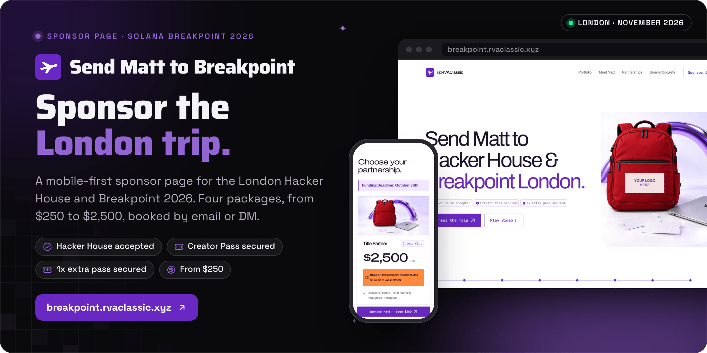
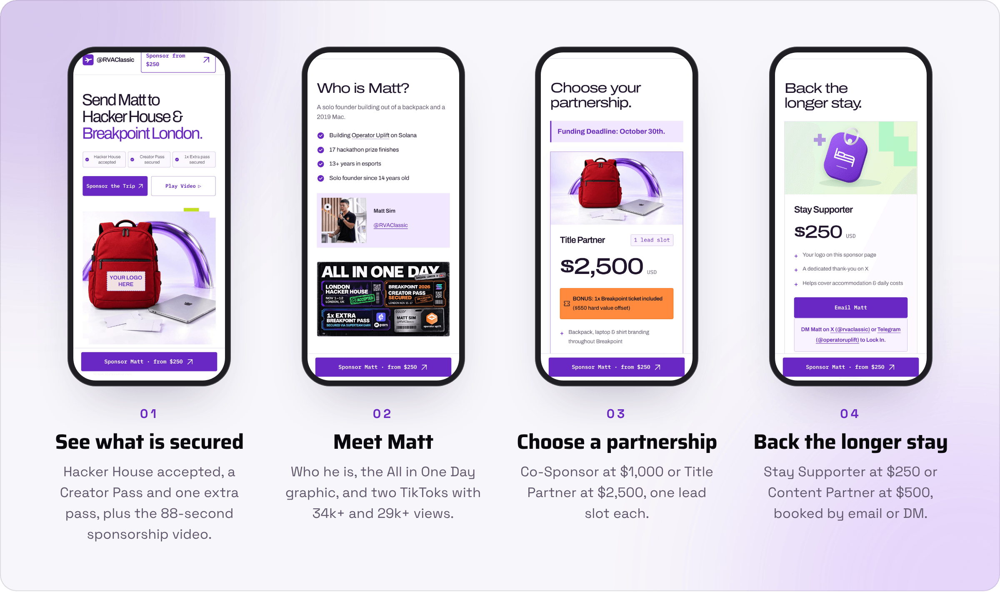
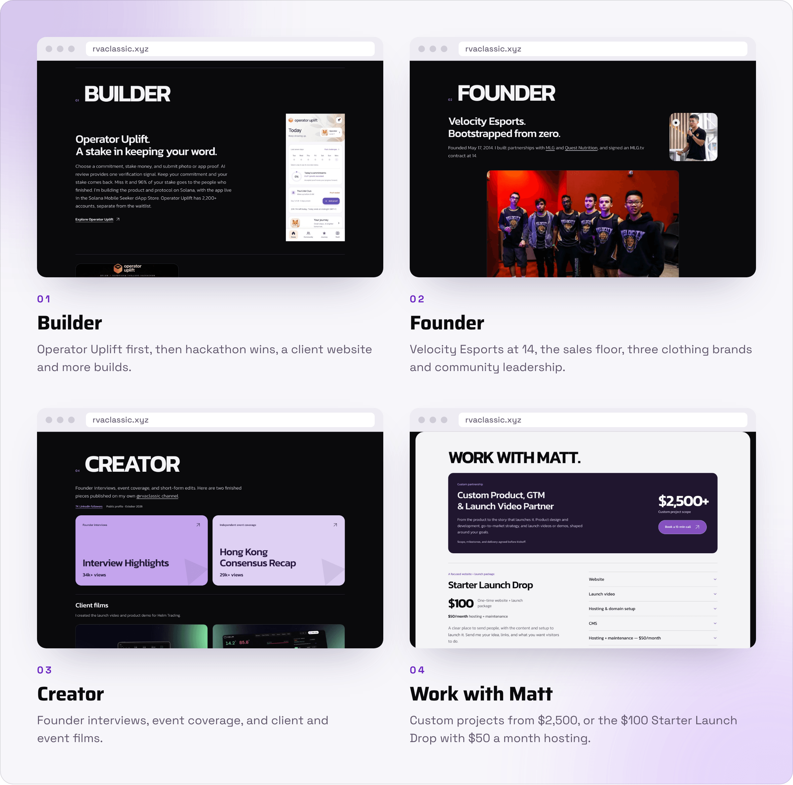

<div align="center">



<br><br>

<a href="https://breakpoint.rvaclassic.xyz/#packages"></a>&nbsp;&nbsp;
<a href="https://rvaclassic.xyz"></a>&nbsp;&nbsp;
<a href="mailto:operatoruplift@gmail.com"></a>

<br><br>

<a href="https://breakpoint.rvaclassic.xyz"></a>
<a href="https://rvaclassic.xyz"></a>


<a href="LICENSE"></a>

<h3>Send Matt to Hacker House &amp; Breakpoint London.</h3>

<b>Meet Matt</b> &nbsp;→&nbsp; <b>See the proof</b> &nbsp;→&nbsp; <b>Pick a package</b> &nbsp;→&nbsp; <b>Email or DM</b>

<br>

<a href="#how-it-works">How it works</a> &nbsp;·&nbsp;
<a href="#the-packages">Packages</a> &nbsp;·&nbsp;
<a href="#the-portfolio-at-rvaclassicxyz">Portfolio</a> &nbsp;·&nbsp;
<a href="#status">Status</a> &nbsp;·&nbsp;
<a href="#run-it-locally">Run it locally</a> &nbsp;·&nbsp;
<a href="#credits-and-sources">Credits</a>

</div>

<br>

<picture>
  <source media="(prefers-color-scheme: dark)" srcset="docs/readme/screens-dark.png">
  
</picture>

<p align="center"><sub>Captured at phone size from a local copy of <code>dist/</code> on 30 October 2026. Prices, dates and view counts are the page's own.</sub></p>

**Send Matt to Breakpoint is the sponsor page for Matt Sim (RVAClassic), founder of Operator Uplift, to attend the London Hacker House and Solana Breakpoint 2026 in London.** It shows what is already secured, introduces Matt, and offers four packages from $250 to $2,500. There is no checkout: every package button opens an email to Matt with the package in the subject line, and sponsors can also DM him on X or Telegram.

The same repository serves Matt's portfolio at [rvaclassic.xyz](https://rvaclassic.xyz) from one Vercel project. Both sites are hand-written static files in `dist/`, with no framework and no build step.

<br>

## How it works

<picture>
  <source media="(prefers-color-scheme: dark)" srcset="docs/readme/flow-dark.png">
  
</picture>

<table>
  <tr valign="top">
    <td width="33%"><b>No build step</b><br><sub>Hand-written HTML, CSS and JavaScript in <code>dist/</code>. Vercel runs no install or build command and serves the folder exactly as committed.</sub></td>
    <td width="33%"><b>One deploy, two hosts</b><br><sub><a href="vercel.json"><code>vercel.json</code></a> sends <code>rvaclassic.xyz</code> to the portfolio, gives each host its own robots file and sitemap, and redirects <code>breakpoint.rvaclassic.xyz/portfolio</code> to the apex with a 308.</sub></td>
    <td width="33%"><b>Light on the network</b><br><sub>Local WebP images, self-hosted fonts on the sponsor page and no analytics script. The 88-second video (about 38 MB) loads only when Play Video is pressed.</sub></td>
  </tr>
</table>

<p align="center"><sub>Static HTML · CSS · vanilla JavaScript · Archivo and IBM Plex Mono, self-hosted under the OFL · Vercel host routing · DNS at Namecheap</sub></p>

<br>

## The packages

As listed on the sponsor page. Each **Email Matt** button opens a pre-filled email to operatoruplift@gmail.com.

<table>
  <tr>
    <th width="24%" align="left">Package</th>
    <th width="12%" align="left">Price</th>
    <th width="64%" align="left">What the sponsor gets</th>
  </tr>
  <tr valign="top">
    <td><b>Title Partner</b><br><sub>1 lead slot</sub></td>
    <td>$2,500</td>
    <td>One extra Breakpoint ticket included ($550 hard value offset). Backpack, laptop and shirt branding throughout Breakpoint. 3 native TikToks or Reels from your booth or activation. 1 protocol deep-dive X thread to 10k+ ecosystem builders. On-the-ground networking and lead gen.</td>
  </tr>
  <tr valign="top">
    <td><b>Co-Sponsor</b><br><sub>1 lead slot</sub></td>
    <td>$1,000</td>
    <td>Laptop branding throughout Breakpoint. 1 dedicated native short-form video. Shoutouts in every Breakpoint recap thread.</td>
  </tr>
  <tr valign="top">
    <td><b>Content Partner</b></td>
    <td>$500</td>
    <td>1 native short-form video for your brand. Your logo on the sponsor page. A dedicated thank-you on X.</td>
  </tr>
  <tr valign="top">
    <td><b>Stay Supporter</b></td>
    <td>$250</td>
    <td>Your logo on the sponsor page. A dedicated thank-you on X. Helps cover accommodation and daily costs.</td>
  </tr>
</table>

The page's own terms: Hacker House attendance depends on timely visa approval and sufficient sponsorship funding. Packages cover Breakpoint; Hacker House participation is not guaranteed. To lock in a package, DM Matt on [X (@rvaclassic)](https://x.com/rvaclassic) or [Telegram (@operatoruplift)](https://t.me/operatoruplift).

<br>

## The portfolio at rvaclassic.xyz

<picture>
  <source media="(prefers-color-scheme: dark)" srcset="docs/readme/portfolio-dark.png">
  
</picture>

<p align="center"><sub>Captured from a local copy of <code>dist/portfolio/</code> on 30 October 2026. The hero is not shown: its sky video and 3D art load from remote hosts this environment cannot reach.</sub></p>

[`dist/portfolio/`](dist/portfolio) is Matt's portfolio, served at the apex domain. It has Builder, Founder, Events and Creator sections, a Featured in section with interviews and articles, and Matt's services: custom product, GTM and launch video projects from $2,500, the Starter Launch Drop (a $100 one-time website and launch package, plus $50 a month for hosting and maintenance), and separately quoted video, design, social and business development work. The public RVAClassic brand kit lives at [`/portfolio/brand/`](dist/portfolio/brand), with logos, favicons, fonts, tokens and the brand guide. [`brand.md`](brand.md) records the palette, type, voice and pricing rules.

<br>

## Status

<table>
  <tr valign="top">
    <td width="16%" align="center"></td>
    <td>The sponsor page at <a href="https://breakpoint.rvaclassic.xyz">breakpoint.rvaclassic.xyz</a>, also at <a href="https://send-matt-to-breakpoint.vercel.app">send-matt-to-breakpoint.vercel.app</a>. It lists a funding deadline of October 30, ahead of the London Hacker House (1 to 12 November) and Breakpoint 2026 (15 to 17 November).</td>
    <td width="22%"><a href="https://breakpoint.rvaclassic.xyz">Sponsor page</a></td>
  </tr>
  <tr valign="top">
    <td align="center"></td>
    <td>Per the page: London Hacker House accepted, a Breakpoint 2026 Creator Pass, and one extra Breakpoint pass via Superteam Earn, which is included with the Title Partner package.</td>
    <td><a href="dist/assets/all-in-one-day-one-pass.webp">All in One Day graphic</a></td>
  </tr>
  <tr valign="top">
    <td align="center"></td>
    <td>Matt's portfolio at <a href="https://rvaclassic.xyz">rvaclassic.xyz</a>, with the brand kit at <code>/portfolio/brand/</code>. Served from this repository by host routing.</td>
    <td><a href="https://rvaclassic.xyz">Portfolio</a></td>
  </tr>
</table>

<br>

## Run it locally

<table>
  <tr valign="top">
    <td width="33%"><b>Prerequisites</b><br><sub>Python 3, or any static file server. Nothing to install or build.</sub></td>
    <td width="33%"><b>Read first</b><br><sub><a href="brand.md">brand.md</a> for the portfolio palette, type and voice, and the <a href="dist/assets/fonts/README.md">font notes</a> before touching typography.</sub></td>
    <td width="33%"><b>What is not here</b><br><sub>No backend, forms, payments or analytics, and no tests. Sponsors book by email, X or Telegram.</sub></td>
  </tr>
</table>

```bash
python3 -m http.server 8080 --directory dist   # serves the folder as is
```

Open http://localhost:8080 for the sponsor page and http://localhost:8080/portfolio/ for the portfolio. Host routing in `vercel.json` only runs on Vercel, so locally the portfolio stays at `/portfolio/`. Its hero sky video, 3D art and Google Fonts need an internet connection.

<details>
<summary><b>Deploy and routing</b></summary>
<br>

The GitHub repository is connected to Vercel. Pushes to `main` deploy the production site. Vercel serves `dist/` directly with the Other framework preset and no build or install command. DNS is managed at Namecheap. Both custom domains are assigned to the Vercel project and serve over HTTPS.

`vercel.json` routes the apex domain to the portfolio before filesystem handling. The Breakpoint subdomain and the Vercel address continue to serve the sponsor page. Shared assets stay under `dist/assets/`.

| Request | `rvaclassic.xyz` | `breakpoint.rvaclassic.xyz` | `*.vercel.app` |
|---|---|---|---|
| `/` | Portfolio (`portfolio/index.html`) | Sponsor page | Sponsor page |
| `/portfolio/` | Portfolio | 308 redirect to `https://rvaclassic.xyz/` | Portfolio |
| `/robots.txt` | `robots-apex.txt` | `robots.txt` | `robots.txt` |
| `/sitemap.xml` | `sitemap-apex.xml` | `sitemap.xml` | `sitemap.xml` |
| `/llms.txt` | `llms-apex.txt` | Not served | `llms-apex.txt` |

Public source: https://github.com/operatoruplift/send-matt-to-breakpoint

</details>

<details>
<summary><b>Site files</b></summary>
<br>

| Path | Contents |
|---|---|
| `dist/index.html` | Sponsor page content, the four packages and social metadata |
| `dist/styles.css` | Responsive layout and visual styling for the sponsor page |
| `dist/site.js` | The sponsorship video dialog |
| `dist/journey.js`, `dist/journey.css` | The repeating journey animation, with visibility and reduced-motion support |
| `dist/assets/` | Locally served images, fonts, illustrations and the sponsorship video |
| `dist/portfolio/index.html` | The portfolio: Builder, Founder, Events, Creator, services and Featured in, with JSON-LD |
| `dist/portfolio/hero.css`, `hero.js` | The responsive sky and projector hero, with reduced-motion and visibility support |
| `dist/portfolio/body.css`, `body.js` | Portfolio sections and progressive entrance effects |
| `dist/portfolio/evidence.css` | Event case studies, sourced hackathon results, creative portfolio links and media appearances |
| `dist/portfolio/projects.css`, `build-previews.css`, `build-previews.js` | The client website case study, featured builds and the expandable catalog, with hover and focus previews |
| `dist/portfolio/` (other CSS) | `awards`, `base`, `brand`, `credibility`, `history`, `media-hover` and `services` styles |
| `dist/portfolio/assets/` | Build previews, film previews and history media |
| `dist/portfolio/brand/` | The public brand kit: asset browser, guide, logos, favicons, fonts, tokens and ZIP |
| `dist/robots*.txt`, `dist/sitemap*.xml`, `dist/llms-apex.txt` | Per-host crawler files, chosen by `vercel.json` |
| `vercel.json` | Static deployment configuration and host routing |
| `brand.md` | RVAClassic visual identity, voice and pricing notes |

</details>

<br>

## Credits and sources

Archivo and IBM Plex Mono provide an open-source approximation of the official Breakpoint typography. Their SIL Open Font Licenses and source attribution are in [`dist/assets/fonts/`](dist/assets/fonts). The proprietary ABC Favorit and BP26 Extended fonts are not bundled.

The London background image comes from the official Solana Breakpoint website. Brand names, logos, personal imagery and sponsorship content identify their respective owners. The red backpack and MacBook artwork was edited with built-in imagegen and compressed to WebP for the site. TikTok view counts were supplied by Matt on October 15, 2026.

The All in One Day graphic and the 88-second sponsorship video were supplied by Matt on October 16, 2026. The video keeps its original 1080p60 H.264/AAC streams, with the MP4 metadata moved to the front for streaming, and loads only when Play Video is selected. The sponsor proof graphic was updated to one extra pass on October 22, 2026 using built-in imagegen; the existing reel carries a current-allocation notice.

<details>
<summary><b>Portfolio content and attribution notes</b></summary>
<br>

The portfolio keeps the sky and projector hero from its supplied template, with Builder, Founder, Events and Creator sections adapted to Matt's real work. The Starter Launch Drop is $100 one-time for the website and launch package, plus $50 a month for hosting and maintenance; initial domain registration and setup are included for now, and scope, delivery date and future domain renewals are agreed before kickoff. Video editing, graphic design, social media management and business development are separate custom projects with brief links and scoped quotes. Product accounts and waitlist numbers are separate; AI review is described as one verification signal. Historical Velocity Esports partnerships are labeled separately from Operator Uplift's use of Solana. The Featured in section links to original features from CEO Weekly, Voyage New York and New York Weekly supplied by Matt, each labeled branded content to match its publication's disclosure. Additional testimonials require original sources before inclusion.

The Featured in section links interviews from Web3 TV, Ivy Tier, Web3 Educator, Matt's Operator Uplift interview archive, Benyam Ephrem, Outpost Lookout and Secret Experts Podcast Episode 18. The original Web3 TV upload replaces the duplicate Operator Uplift repost. The unlisted archive link was supplied for inclusion by Matt; the Spotify episode covers an earlier AI-agent chapter of Operator Uplift. Thumbnails for the YouTube interviews come from the linked uploads. LinkedIn reach is the rounded public-profile count displayed on October 22, 2026. The Actioners and The Residency story links Matt's own posts documenting the rejection and later selection. Empower acceptance and Founders Inc workspace use were confirmed by Matt; workspace use is not described as program acceptance.

Event case-study counts and roles, clothing-brand names and McShin Foundation roles were confirmed firsthand by Matt. RSVP counts, accepted guests and attendance remain distinct. The uncertain founder-event prize was omitted. The Photon case links the complete client-published recap, while a separate client post supplies Matt's camera credit. Event photos and the Render Hackathon photo come from Matt's public posts and are compressed to WebP. Interviews link to their original hosts; client and event films play a muted preview on hover or focus and link to the full MP4. The hackathon list is ordered by total event prize pool and labels pools as event totals, not Matt's payouts. Exact MCP course titles are not invented; the page links LinkedIn's certifications section.

Attribution corrections: Epic Games is an RVAClassic creator partnership, while MLG and Quest Nutrition remain in the Velocity Esports context. Other creator partnerships are separate from the expandable list of past teams and collaborations, which does not label every relationship as employment or a formal partnership. Lovable, icm.run and Operator Uplift are the corrected event labels; the NOIR event shows Matt's 75+ RSVPs and about 20 attendees. Speaking and pitches are not presented as brand partnerships. Esports links distinguish personal playing results from the Fatal Ambition roster's team result; sponsored placements from the old resumes are not treated as Matt's individual results.

Helm Trading's launch video and product demo link to the official client posts, with authorship confirmed by Matt. The Eva Tarot case study shows Matt's confirmed website, launch-video and social-strategy deliverables. The other builds, four featured with previews and seven in the expandable catalog, use their observed landing-page descriptions; previews and demos are not presented as universally production-ready products. The Superteam Malaysia hostname typo was corrected to `superteammalaysia.vercel.app`. Road to Breakpoint DLMM timed out initially, then returned HTTP 200 on both HEAD and GET retries; transactional functionality is untested. Full resume PDFs and their personal contact details are not published.

The portfolio hero and decorative 3D assets use the remote URLs supplied with the templates. Playfair Display, DM Sans, Poppins and Kanit are loaded from Google Fonts. The portfolio logo files come from Epic Games' Unreal Engine CDN, MLG's official Amazon S3 assets, Quest Nutrition's website and [Solana's branding page](https://solana.com/branding). The two recommendations, from Royston G. King and Snow Wong, link to [Matt's LinkedIn profile](https://www.linkedin.com/in/rvaclassic/), where they are published.

</details>

<br>

<p align="center"><sub>The site's code is MIT licensed (see <a href="LICENSE">LICENSE</a>); the photographs and written content are not covered. Third-party names, logos and imagery belong to their owners; the brand kit's terms are in <a href="dist/portfolio/brand/LICENSE-AND-SOURCES.md">LICENSE-AND-SOURCES.md</a>.</sub></p>

<p align="center"><sub>Built by <a href="https://rvaclassic.xyz">Matt Sim</a>, founder of <a href="https://operatoruplift.com">Operator Uplift</a>. More builds at <a href="https://github.com/operatoruplift">github.com/operatoruplift</a>. Want one built for your product? <a href="https://cal.com/rvaclassic/15min">Book a 15-minute call</a>.</sub></p>
